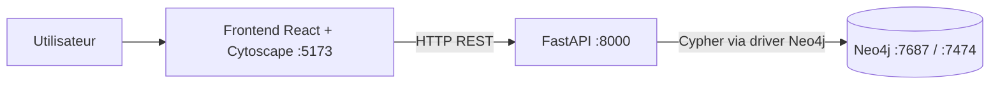

# OSINT Graph Web - Documentation de fonctionnement

Ce dépôt contient la version web d'OSINT Graph : `backend/`, `frontend/` et
le lanceur Windows. La version de bureau hors ligne est maintenue séparément
dans le dépôt `osint-graph-desktop`.

## Licence du code applicatif

Le code de la version web utilise les mêmes conditions que la version desktop :
la licence personnalisée
[OSINT Graph — Free Redistribution, No Sale License](LICENSE).

- Utilisation, étude, modification et redistribution gratuites autorisées,
  y compris au sein d'une entreprise.
- Vente du logiciel ou d'une version modifiée, facturation d'une licence ou
  paiement imposé pour obtenir une copie interdits.
- Licence et mentions de copyright à conserver dans les copies redistribuées ;
  les versions modifiées doivent être identifiées comme telles.
- Les prestations distinctes de support, formation, installation ou
  développement peuvent être facturées si elles ne conditionnent pas l'accès
  au logiciel distribué ou l'exercice des droits accordés.
- Les modifications privées n'ont pas à être publiées. Le dépôt est public et
  les destinataires peuvent partager gratuitement leurs copies selon la licence.

L'interdiction de vente signifie qu'il ne s'agit pas d'une licence open source
au sens de l'[Open Source Initiative](https://opensource.org/osd).
Le texte complet de [LICENSE](LICENSE) fait foi. Les dépendances conservent
leurs propres licences, décrites dans [THIRD_PARTY.md](THIRD_PARTY.md).
Le build du frontend inclut ces deux fichiers dans `frontend/dist/`.

## 1) Vue d'ensemble

Ce projet est une preuve de concept (PoC) de graphe OSINT :

- Un **backend FastAPI** expose une API REST.
- Une base **Neo4j** stocke des personnes et des relations.
- Un **frontend React + Cytoscape** permet de creer des noeuds/liens et de visualiser le graphe.
- Un script Windows `start.bat` peut demarrer l'infra locale (Docker Neo4j + backend + frontend).

## Get Started

### Prerequis

- Docker Desktop (lance)
- Python (avec `venv` et `pip`)
- Node.js + npm

### Demarrage rapide (Windows recommande)

Lors du premier lancement après un clonage, installer les dépendances depuis
la racine du dépôt :

```powershell
python -m venv backend/venv
.\backend\venv\Scripts\python.exe -m pip install -r backend/requirements.txt
npm.cmd --prefix frontend ci
```

Depuis la racine du projet :

```powershell
.\start.bat
```

Le lanceur utilise le dossier dans lequel il se trouve ; le dépôt peut être
cloné à l'emplacement de votre choix.

Puis ouvrir :

- Frontend : `http://localhost:5173`
- API docs : `http://localhost:8000/docs`
- Neo4j Browser : `http://localhost:7474`

### Premier acces et securite

L'application demande maintenant une authentification.

Variables d'environnement utiles pour initialiser le premier administrateur :

- `APP_BOOTSTRAP_ADMIN_ID` : identifiant du compte admin initial
- `APP_BOOTSTRAP_ADMIN_PASSWORD` : mot de passe du compte admin initial
- `APP_BOOTSTRAP_ADMIN_NAME` : nom affiche de ce compte

Exemple PowerShell avant de lancer le backend :

```powershell
$env:APP_BOOTSTRAP_ADMIN_ID="admin"
$env:APP_BOOTSTRAP_ADMIN_PASSWORD="ChangeMe123!"
$env:APP_BOOTSTRAP_ADMIN_NAME="Administrateur"
```

Si `APP_BOOTSTRAP_ADMIN_PASSWORD` n'est pas fourni au premier demarrage, un mot de passe temporaire est genere et affiche dans la console backend.

### Demarrage manuel (si besoin)

Backend :

```powershell
cd backend
python -m venv venv
.\venv\Scripts\activate
pip install -r requirements.txt
uvicorn main:app --reload --port 8000
```

Frontend :

```powershell
cd frontend
npm install
npm run dev
```

Neo4j (Docker) :

```powershell
docker run -d -p 7474:7474 -p 7687:7687 -e NEO4J_AUTH=neo4j/neo4j123 --name neo4j-osint neo4j:5
```

## 2) Structure du projet

```text
osint-graph-web/
|- backend/
|  |- main.py
|  |- requirements.txt
|- frontend/
|  |- src/
|  |  |- App.jsx
|  |  |- main.jsx
|  |  |- App.css
|  |  |- index.css
|  |- package.json
|  |- vite.config.js
|  |- index.html
|- .gitignore
|- README.md
|- start.bat
```

Les environnements Python, `node_modules`, fichiers `.env`, bases SQLite,
exports et sauvegardes locaux sont exclus de Git. Les comptes et données
d'enquête ne font pas partie du dépôt.

## 3) Architecture et flux



Flux principal :

1. L'utilisateur se connecte via `POST /auth/login`.
2. Le frontend charge `GET /graphs` pour connaitre les graphes accessibles.
3. Le graphe courant est selectionne cote frontend.
4. Toutes les operations de lecture/ecriture passent ensuite avec un `graph_id`.
5. Le backend verifie le role de l'utilisateur sur ce graphe avant d'executer les requetes Neo4j.

## 4) Backend (FastAPI + Neo4j)

Fichier principal : `backend/main.py`.

### 4.1 Configuration

Variables d'environnement supportees :

- `NEO4J_URI` (defaut: `bolt://localhost:7687`)
- `NEO4J_USER` (defaut: `neo4j`)
- `NEO4J_PASSWORD` (defaut: `neo4j123`)
- `APP_SECURITY_DB` : chemin du fichier SQLite de securite
- `APP_BOOTSTRAP_ADMIN_ID` : admin cree au premier lancement
- `APP_BOOTSTRAP_ADMIN_PASSWORD` : mot de passe admin initial
- `APP_BOOTSTRAP_ADMIN_NAME` : nom affiche de l'admin initial
- `APP_DEFAULT_GRAPH_ID` / `APP_DEFAULT_GRAPH_NAME` : graphe cree automatiquement
- `APP_SESSION_TTL_HOURS` : duree de validite d'une session bearer
- `APP_LOGIN_MAX_FAILURES` / `APP_LOGIN_LOCK_MINUTES` : verrouillage apres echecs
- `APP_PASSWORD_MIN_LENGTH` : politique minimale de mot de passe
- `APP_CORS_ORIGINS` : liste CSV des origines frontend autorisees

Le driver Neo4j est initialise au chargement de l'application.

### 4.2 Modele de donnees

Le backend utilise maintenant deux stockages :

- `Neo4j` : personnes et relations du graphe
- `SQLite` : utilisateurs, sessions, graphes applicatifs et permissions

Tables SQLite principales :

- `users` : identifiant, hash `scrypt`, etat de verrouillage
- `sessions` : jetons bearer haches et dates d'expiration
- `graphs` : graphes applicatifs
- `graph_permissions` : role `viewer` / `editor` / `admin` par graphe

Noeud `Person` :

- `id` : UUID genere
- `graph_id` : identifiant logique du graphe auquel le noeud appartient
- `alias` : identifiant metier dans un graphe donne
- `nom` : optionnel
- `prenom` : optionnel
- `date_naissance` : optionnelle
- `date_mort` : optionnelle
- `age` : calcule automatiquement a partir des dates
- `entreprise` : optionnel
- `description` : notes libres optionnelles

Relation entre `Person` :

- Type dynamique base sur `label` envoye a l'API (ex: `CONNAIT`)
- Propriete `id` (UUID) au moment de la creation
- Propriete `graph_id` pour isoler les relations par graphe

### 4.3 Endpoints exposes

- `GET /` : redirige vers `/docs` (Swagger UI)
- `POST /auth/login` : ouvre une session
- `POST /auth/logout` : revoque la session courante
- `GET /auth/me` : utilisateur courant
- `GET /graphs` : graphes accessibles a l'utilisateur
- `POST /graphs` : cree un nouveau graphe et rend le createur administrateur
- `GET /graphs/{graph_id}/permissions` : liste des acces d'un graphe
- `POST /graphs/{graph_id}/permissions` : ajoute/met a jour un acces
- `PUT /graphs/{graph_id}/permissions/{user_id}` : change un role
- `DELETE /graphs/{graph_id}/permissions/{user_id}` : retire un acces
- `POST /persons?graph_id=...` : cree une personne
- `GET /persons?graph_id=...` : liste des personnes du graphe
- `GET /persons/{person_id}` : detail d'une personne
- `PUT /persons/{person_id}` : modifie une personne
- `DELETE /persons/{person_id}` : supprime une personne
- `GET /companies?graph_id=...` : liste distincte des entreprises du graphe
- `POST /relations?graph_id=...` : cree une relation orientee
- `GET /graph?graph_id=...` : retourne le graphe complet `{ nodes, edges }`
- `GET /graph/export?graph_id=...` : exporte le graphe courant en JSON
- `POST /graph/import?graph_id=...` : importe un graphe JSON dans le graphe courant

Formats renvoyes :

- Node : `{ id, label, type, info_categories }`
- Edge : `{ id, source, target, label, company? }`
- GraphResponse : `{ nodes: Node[], edges: Edge[] }`

### 4.4 Details de logique importants

- Les mots de passe sont haches avec `scrypt`.
- Les sessions d'API sont des jetons bearer aleatoires, stockes haches en SQLite avec expiration.
- Plusieurs echecs de connexion consecutifs verrouillent temporairement le compte.
- Chaque operation de graphe est protegee par un role sur le graphe courant :
- `viewer` : lecture / export
- `editor` : creation, modification, suppression, import
- `admin` : gestion des acces du graphe en plus des droits `editor`
- Toutes les requetes Neo4j filtrent maintenant par `graph_id`.
- `POST /persons` refuse un alias deja present dans le meme graphe.
- Si `alias` est vide mais `nom` + `prenom` sont renseignes, l'alias est genere automatiquement avec `nom prenom`.
- Si seul `nom` ou seul `prenom` est renseigne, un `alias` explicite est obligatoire.
- `nom`, `prenom`, `date_naissance`, `date_mort`, `entreprise`, `description` sont optionnels.
- `age` est calcule cote backend a partir de `date_naissance` et `date_mort` (ou la date du jour si la personne est vivante).
- Validation metier : `date_mort >= date_naissance` et pas de `date_naissance` dans le futur.
- Creation/modification personne : liens `MEME_ENTREPRISE` maintenus automatiquement entre personnes partageant la meme entreprise.
- `POST /relations` utilise le `label` comme **type de relation Cypher**.
- `GET /graph` deduplique les noeuds et liens via des dictionnaires Python.
- `GET /graph/export` retourne un snapshot transportable du graphe.
- `POST /graph/import` peut remplacer uniquement le graphe courant avant import.
- Un graphe par defaut est cree automatiquement au premier lancement, et les donnees legacy non scopees sont rattachees a ce graphe.
- Le frontend permet un filtrage relationnel (par noeud, type de lien, profondeur).

## 5) Frontend (React + Vite + Cytoscape)

Fichiers cles :

- `frontend/src/main.jsx` : bootstrap React.
- `frontend/src/App.jsx` : logique applicative principale.

### 5.1 Etat et appels API

`App.jsx` maintient :

- le jeton de session, l'utilisateur courant, la liste des graphes et le graphe selectionne
- `graph` : noeuds/aretes du backend
- `persons` : liste des personnes (pour les selecteurs de relation)
- les etats de formulaires pour creation de personne, de lien et l'administration

Appels :

- `handleLogin()` -> `POST /auth/login`
- `fetchAvailableGraphs()` -> `GET /graphs`
- `fetchGraph()` -> `GET /graph?graph_id=...`
- `fetchPersons()` -> `GET /persons?graph_id=...`
- `fetchCompanies()` -> `GET /companies?graph_id=...`
- `handleCreateGraph()` -> `POST /graphs`
- `handleGrantPermission()` -> `POST /graphs/{graph_id}/permissions`
- `handleCreatePerson()` -> `POST /persons?graph_id=...` puis refresh
- `loadPersonDetails()` -> `GET /persons/{id}?graph_id=...`
- `handleUpdatePerson()` -> `PUT /persons/{id}?graph_id=...` puis refresh
- `handleDeletePerson()` -> `DELETE /persons/{id}?graph_id=...` puis refresh
- `handleCreateRelation()` -> `POST /relations?graph_id=...` puis refresh graphe
- `handleExportGraph()` -> `GET /graph/export?graph_id=...`
- `handleImportGraph()` -> `POST /graph/import?graph_id=...`

### 5.2 Rendu du graphe

- Cytoscape est initialise une seule fois (`cyRef` + `containerRef`).
- Les elements affiches sont recalcules a chaque changement de donnees.
- Le recentrage automatique se fait quand les donnees/filtre du graphe changent, pas pendant la saisie des formulaires.
- Layout utilise : `cose`.
- Bouton UI : Rafraichir le graphe.
- Bouton UI : Recentrer (`fit`).
- En-tete lateral : connexion, selection de graphe, creation de graphe.
- Panneau admin : attribution / retrait des droits sur le graphe courant.
- Boutons UI : Exporter JSON / Importer JSON (snapshot complet du graphe).
- Clic sur un noeud : ouverture d'un encart de details avec edition.
- Dans l'encart : bouton de suppression de la personne.
- Champ entreprise : suggestions depuis la base + saisie libre possible.
- Filtre relationnel combine:
- un noeud de depart (optionnel),
- un type de lien (optionnel),
- une profondeur en nombre de poignees de main.
- Les formulaires (filtre, creation personne, creation lien, edition) sont repliables/deroulables.

Comportement de securite :

- Sans session valide, le frontend affiche uniquement l'ecran de connexion.
- Si l'utilisateur n'a qu'un droit `viewer`, les formulaires d'ecriture sont remplaces par des messages de consultation seule.

### 5.3 Styling

- L'interface principale utilise surtout des styles inline dans `App.jsx`.
- `App.css` et `index.css` contiennent principalement le style Vite par defaut et ne pilotent pas vraiment l'UI finale.

## 6) Demarrage local

### Option A - Script automatique (Windows)

Lancer `start.bat` depuis la racine.

Le script :

1. Verifie/Demarre Docker Desktop.
2. Cree ou demarre le container `neo4j-osint` (image `neo4j:5`).
3. Ouvre un terminal backend avec `uvicorn main:app --reload --port 8000`.
4. Ouvre un terminal frontend avec `npm run dev`.

Ports utilises :

- Frontend : `5173`
- Backend : `8000`
- Neo4j Browser : `7474`
- Neo4j Bolt : `7687`

### Option B - Demarrage manuel

Backend :

```powershell
cd backend
python -m venv venv
.\venv\Scripts\activate
pip install -r requirements.txt
uvicorn main:app --reload --port 8000
```

Frontend :

```powershell
cd frontend
npm install
npm run dev
```

Neo4j (exemple Docker) :

```powershell
docker run -d -p 7474:7474 -p 7687:7687 -e NEO4J_AUTH=neo4j/neo4j123 --name neo4j-osint neo4j:5
```

## 7) Contrat API rapide

Creer une personne :

```http
POST /persons
Content-Type: application/json

{
  "alias": "alice",
  "nom": "Dupont",
  "prenom": "Alice",
  "date_naissance": "1994-05-10",
  "date_mort": null,
  "entreprise": "Acme",
  "description": "Source principale: rapport interne"
}
```

Modifier une personne :

```http
PUT /persons/{person_id}
Content-Type: application/json

{
  "alias": "alice_new",
  "nom": "Dupont",
  "prenom": "Alice",
  "date_naissance": "1994-05-10",
  "date_mort": null,
  "entreprise": "Acme",
  "description": "Notes mises a jour"
}
```

Supprimer une personne :

```http
DELETE /persons/{person_id}
```

Creer une relation :

```http
POST /relations
Content-Type: application/json

{
  "from_id": "uuid-personne-a",
  "to_id": "uuid-personne-b",
  "label": "CONNAIT"
}
```

Lire le graphe :

```http
GET /graph
```

## 8) Limites actuelles (constatees)

- Pas de suppression/mise a jour explicite des relations.
- Validation limitee du champ `label` de relation.
- Pas de tests automatiques (backend ou frontend) dans le depot.
- `frontend/README.md` reste le README standard Vite (non specifique au projet).

## 9) Dependances principales

Backend :

- `fastapi`
- `uvicorn[standard]`
- `neo4j`
- `pydantic`
- `python-dotenv`

Frontend :

- `react`, `react-dom`
- `vite`
- `axios`
- `cytoscape`
