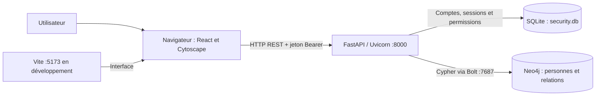

# Architecture et stack technique

[Retour à la documentation](../README.md)

Ce document explique les composants et les données. Les commandes de lancement
se trouvent dans [Installation](INSTALLATION.md), et l'organisation du code
dans [Développement](DEVELOPPEMENT.md).

## Rôle des composants

| Composant | Rôle dans le projet |
| --- | --- |
| JavaScript, React et React DOM | Construisent l'interface du navigateur : connexion, bibliothèque, formulaires et état de l'écran. |
| Cytoscape.js | Dessine les nœuds et les relations, calcule leur disposition et gère la navigation dans le graphe. |
| Axios | Envoie les requêtes HTTP du frontend à l'API avec le jeton de session et le graphe sélectionné. |
| Vite et son plugin React | Fournissent le serveur de développement et produisent les fichiers statiques du frontend. |
| ESLint | Analyse le code JavaScript et les règles liées aux hooks React. |
| Python et FastAPI | Exposent l'API REST, contrôlent les accès et appliquent les règles de gestion. |
| Pydantic | Décrit et valide les structures des requêtes et des réponses de l'API. |
| Uvicorn | Exécute l'application FastAPI comme serveur HTTP. |
| Pilote Python Neo4j et Cypher | Permettent au backend de lire et modifier le graphe dans Neo4j. |
| Neo4j | Stocke les personnes et leurs relations. |
| SQLite, via le module Python `sqlite3` | Stocke les comptes, sessions, métadonnées des graphes et permissions dans un fichier local au backend. |
| Docker | Exécute le serveur Neo4j dans le parcours de démarrage fourni. |
| `start.bat` et PowerShell | Orchestrent le démarrage local sous Windows. |

Les dépendances sont déclarées dans
[backend/requirements.txt](../backend/requirements.txt) et
[frontend/package.json](../frontend/package.json). Le
[verrou npm](../frontend/package-lock.json) fixe les versions installées par
`npm ci`. `react-cytoscapejs` est déclaré, mais l'interface utilise directement
Cytoscape ; `python-dotenv` est déclaré, mais le backend ne charge pas
automatiquement de fichier `.env`.

## Circulation des données

1. L'utilisateur se connecte ; le backend vérifie ses identifiants et crée une session.
2. Le frontend charge la liste des graphes accessibles.
3. L'utilisateur choisit un graphe ; son identifiant accompagne les appels suivants.
4. Le backend vérifie la session et le rôle dans SQLite.
5. Il lit ou modifie les données Neo4j dans le périmètre de ce `graph_id`.
6. Le frontend met à jour les formulaires et la visualisation.

Le navigateur ne se connecte directement à aucune des deux bases.
Neo4j Browser, sur le port `7474`, est un outil d'administration séparé.

## Modèle de données

SQLite conserve les informations qui déterminent qui peut accéder aux graphes :

| Table | Contenu |
| --- | --- |
| `users` | Identifiant, nom affiché, hash du mot de passe, désactivation et verrouillage temporaire. |
| `sessions` | Hash du jeton de session, expiration et révocation. |
| `graphs` | Identifiant, nom, description, créateur et dates du graphe applicatif. |
| `graph_permissions` | Association compte/graphe avec un rôle `viewer`, `editor` ou `admin`. |

Neo4j conserve les données représentées dans le studio :

| Élément | Propriétés principales |
| --- | --- |
| Nœud `Person` | `id`, `graph_id`, `alias`, `nom`, `prenom`, `date_naissance`, `date_mort`, `age`, `entreprise` et `description`. |
| Relation entre personnes | Type issu du `label` demandé, `id` et `graph_id` ; des propriétés supplémentaires existent pour les liens automatiques. |

Les identifiants des personnes et relations créées par l'application sont
des UUID. Le `graph_id` rattache ces données au graphe décrit dans SQLite.
Conserver seulement l'une des bases ne suffit donc pas à restaurer
l'ensemble de l'application.

## Règles de gestion

- La création et la modification d'une personne contrôlent l'unicité de son
  alias dans le graphe. Un nom et un prénom complets peuvent fournir l'alias.
- Les dates sont au format ISO. Une date de décès antérieure à la naissance
  est refusée ; sans date de décès, la naissance ne peut pas être future.
- L'âge est calculé à partir de la naissance et de la date de référence.
- Les liens `MEME_ENTREPRISE` sont mis à jour lors des changements de personne
  et reconstruits après un import.
- Le type d'une relation est un identifiant Cypher dynamique, échappé par le backend.
- L'import peut remplacer le graphe ciblé ou fusionner ses enregistrements.
  Il utilise le `graph_id` de destination et recalcule les liens d'entreprise.
- Au démarrage, le backend initialise SQLite, assure la présence du compte
  initial et du graphe par défaut, puis rattache à ce graphe les anciennes
  données Neo4j dépourvues de `graph_id`.

Les formats de visualisation et les fichiers d'échange sont distincts :
voir la [référence API](API.md).
